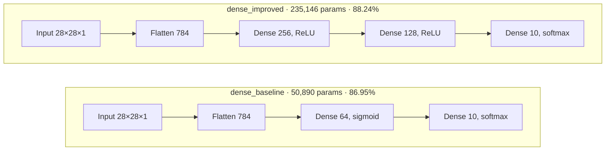
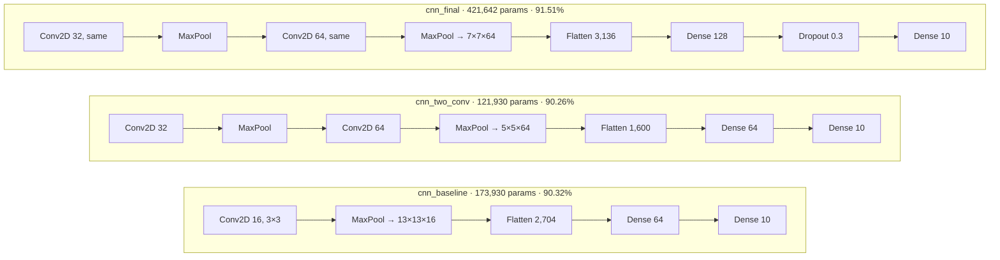

# Fashion-MNIST Clothing Classifier

A comparison of seven neural networks for classifying clothing images, built with
TensorFlow/Keras. The best model, a convolutional neural network with padding and
dropout, reaches **91.51% test accuracy** on the 10,000-image Fashion-MNIST test set.

**[Live demo](https://huggingface.co/spaces/kverma19/fashion-mnist-classifier)** ·
**[Open the notebook in Colab](https://colab.research.google.com/github/kunalv14/fashion-mnist-classifier/blob/main/notebooks/fashion_mnist_experiments.ipynb)**


## What the experiments show

1. **Layer type mattered most.** The simplest CNN (90.32%) beat the best dense network
   (88.24%) with fewer parameters. Convolution keeps the 2D layout of the image and shares
   each filter across every position; `Flatten` + dense layers lose which pixels are neighbours.
2. **Depth only helps if information reaches the classifier.** Adding a second unpadded conv
   layer gave no gain (90.26% vs 90.32%): two poolings shrank features to 5 × 5 × 64 and squeezed
   them into 64 neurons. Adding `padding='same'`, a 128-neuron dense layer and dropout removed
   that bottleneck and gave the best result (91.51%).
3. **The optimizer can undo a good architecture.** Retraining the best CNN with plain SGD
   (lr 0.01) dropped it to 84.43%, below the simplest dense network. A 10× higher Adam
   learning rate (0.01) cost 1.31 points by overshooting the loss minimum.
4. **More parameters ≠ more accuracy.** The dense network gained only 1.29 points from 4.6×
   more parameters, while the smallest CNN outperformed both dense models.

## Results

All models: 10 epochs, batch size 128, categorical cross-entropy, seed 42.

| Rank | Model | Optimizer, learning rate | Parameters | Test accuracy |
| ---: | --- | --- | ---: | ---: |
| 1 | `cnn_final` | Adam, 0.001 | 421,642 | **91.51%** |
| 2 | `cnn_baseline` | Adam, 0.001 | 173,930 | 90.32% |
| 3 | `cnn_two_conv` | Adam, 0.001 | 121,930 | 90.26% |
| 4 | `cnn_final_adam_lr0_01` | Adam, 0.01 | 421,642 | 90.20% |
| 5 | `dense_improved` | Adam, 0.001 | 235,146 | 88.24% |
| 6 | `dense_baseline` | Adam, 0.001 | 50,890 | 86.95% |
| 7 | `cnn_final_sgd_lr0_01` | SGD, 0.01 | 421,642 | 84.43% |

Results from one run on a Colab T4 GPU; re-runs vary by a few tenths of a percent.

## Architectures

**Dense networks**



**Convolutional networks**



All conv layers use 3 × 3 filters and ReLU; all pooling is 2 × 2.

## Run it yourself

**In Colab (easiest):** open the notebook with the link above, choose
Runtime → Change runtime type → T4 GPU, then Runtime → Run all (about 5 minutes).

**Locally:**

```bash
git clone https://github.com/kunalv14/fashion-mnist-classifier.git
cd fashion-mnist-classifier
pip install -r requirements.txt

python src/train.py --experiments all          # all 7 experiments → results/results.csv
python src/train.py --experiments cnn_final \
    --model-out app/fashion_cnn.keras --export-examples app/examples   # model for the demo
```

**Demo app locally:**

```bash
pip install -r app/requirements.txt gradio
python app/app.py
```

## Project structure

```
├── app/                    Gradio demo (deployed to Hugging Face Spaces)
│   ├── app.py
│   ├── fashion_cnn.keras   trained final CNN
│   ├── examples/           one test image per class
│   └── requirements.txt
├── notebooks/
│   └── fashion_mnist_experiments.ipynb
├── src/
│   ├── data.py             load and preprocess Fashion-MNIST
│   ├── models.py           the five architectures
│   └── train.py            run experiments, save results and best model
├── results/results.csv
└── docs/results.png
```

## Demo notes

The model was trained on 28 × 28 grayscale images of single items on a black background.
The demo converts uploads to that format (grayscale, inverts light backgrounds, crops,
resizes), so product-style photos of one item on a plain background work best.

## Tech

Python · TensorFlow / Keras · NumPy · pandas · Matplotlib · Gradio · Hugging Face Spaces

## License

MIT
